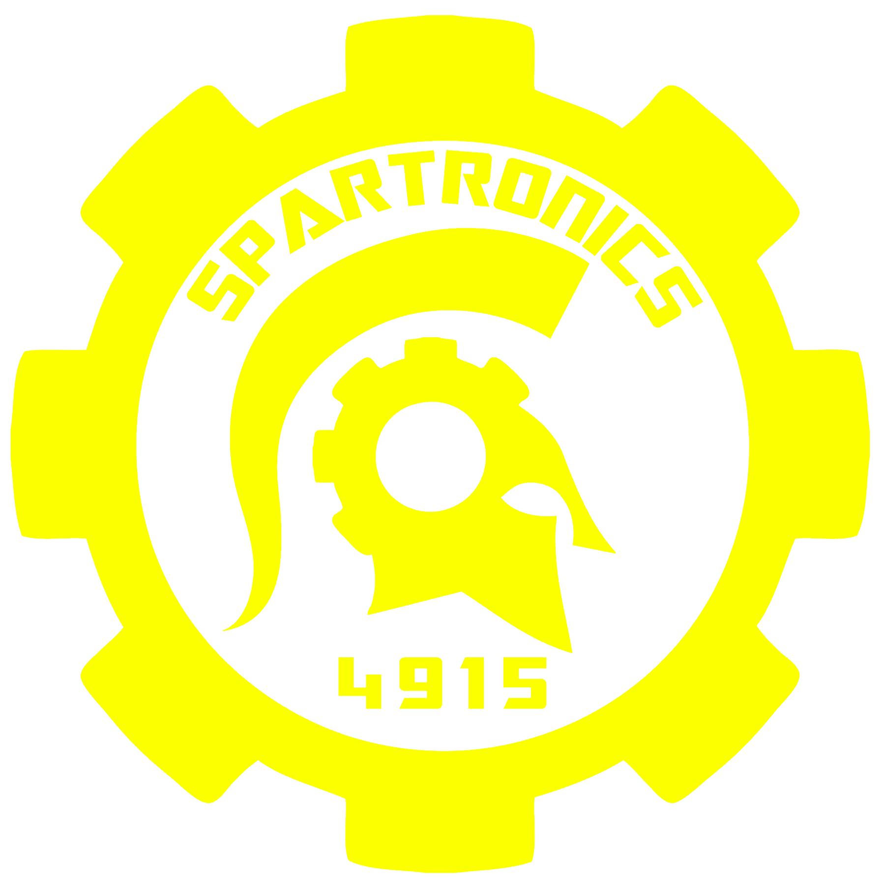

<h1 align="center">
    <picture src="./Logo.png" style="width: 25%">
        
    </picture>
</h1>

This is the official github organization for FRC Team 4915, Spartronics, based in Bainbridge High School on Bainbridge Island, Washington. We are a high school robotics team dedicated to inspiring youth in STEM through hands-on engineering, software development, community outreach, and collaborative problem-solving.

We are currently switching from being a Java based team to a Python based team, and plan to port many of the popular frc vendor dependencies that we use to python along with us, so stay tuned for python ports that'll be listed right here in the readme once they're ready for release.

Our latest robot is [ARTEMIS](https://github.com/Spartronics4915/2026-Rebuilt), making it all the way to Einsteins during the FIRST Championship. For more info about our robots or donating, visit [spartronics4915.com](https://spartronics4915.com).

---

    

        <b>Previous Years (Click to expand)</b>
    

## [2026 Rebuilt](https://github.com/Spartronics4915/2026-Rebuilt) — ARTEMIS
**EPA Percentile**: Top 6%
- **Offseason**: Built a [turret mechanism](https://github.com/Spartronics4915/Skopos-Turret) in anticipation of a shooting game.
- **Glacier Peak**: Rank 3, 1st Pick of Alliance 1, Event Winners, Innovation in Control Award.
- **Clackamas Academy**: Rank 9, 1st Pick of Alliance 3, featured on [Pit Stop](https://www.youtube.com/shorts/c2czZJM7ifA).
- **PNW District Championship**: Rank 11, 1st Pick of Alliance 2.
- **FIRST Championship (Milstein Division)**: Rank 26, 2nd Pick of Alliance 2 (with 1678 Citrus Circuits & 2481 Roboteers), Division Winners.
- **FIRST Championship (Einstein Field)**: Quarterfinalists (lost final match by 3 points).
- **Bordie Blast**: Rank 1, Alliance 1 Captain.
- **Washington Girls' Generation**: Rank 13, 1st Pick of Alliance 4.

---

## [2025 Reefscape](https://github.com/Spartronics4915/2025-Reefscape) — EPHYRA
**EPA Percentile**: Top 10%
- **Sammamish**: Rank 7, 1st Pick of Alliance 3, Innovation in Control Award.
- **Auburn**: Rank 3, Alliance 3 Captain, Semifinalists.
- **PNW District Championship**: Dean's List Winner (advanced to FIRST Championship).
- **Washington Girls' Generation**: Rank 4, 1st Pick of Alliance 2, Event Finalists.

---

## [2024 Crescendo](https://github.com/spartronics4915/2024-crescendo) — NEMESIS
**EPA Percentile**: Top 30%
- **Glacier Peak**: 2nd Pick of Alliance 2, Event Finalists.
- **Bonney Lake**: Rank 11, Alliance 7 Captain, Innovation in Control Award.
- **Washington Girls' Generation**: Alliance 4 Captain, Semifinalists (restarted team tradition).

---

## [2023 Charged Up](https://github.com/Spartronics4915/2023-ChargedUp) — TALOS
**EPA Percentile**: Top 24%
- **Glacier Peak**: Rank 6, Alliance 5 Captain.
- **Auburn**: Rank 6, 1st Pick of Alliance 3, Imagery/Judge's Award.
- **PNW District Championship**: 2nd Pick of Alliance 2.

---

## [2022 Rapid React](https://github.com/Spartronics4915/2022-RapidReact) — HERMES
**EPA Percentile**: Top 20%
- **Sammamish**: 2nd Pick of Alliance 4.
- **Auburn**: Rank 4, Alliance 3 Captain, Team Spirit Award.
- **PNW District Championship**: Rank 32, Quarterfinalists.

---

## [2020 Infinite Recharge](https://github.com/Spartronics4915/2020-InfiniteRecharge) — ATHENA
**EPA Percentile**: Top 38%
- **Glacier Peak**: Rank 7, Alliance 4 Captain, District Engineering Inspiration Award.

---

## [2019 Destination: Deep Space](https://github.com/Spartronics4915/2019-DeepSpace) — CHAOS
**EPA Percentile**: Top 60%
- **Auburn Mountainview**: 1st Pick of Alliance 6.
- **Glacier Peak**: District Engineering Inspiration Award.
- **Washington Girls' Generation**: 2nd Pick of Alliance 5.

---

## [2018 Power Up](https://github.com/Spartronics4915/2018-POWERUP) — THEMIS
**EPA Percentile**: Top 15%
- **Mount Vernon**: Rank 9, 1st Pick of Alliance 5, Event Finalists, Industrial Design Award sponsored by General Motors.
- **Glacier Peak**: 1st Pick of Alliance 5.
- **PNW District Championship**: Rank 32.
- **Washington Girls' Generation**: Event Finalists.

---

## [2017 Steamworks](https://github.com/Spartronics4915/2017-STEAMworks) — HELIOS
**EPA Percentile**: Top 3%
- **Auburn Mountainview**: Rank 1, Alliance 1 Captain, Event Winners, District Engineering Inspiration Award.
- **Glacier Peak**: Rank 1, Alliance 1 Captain, Semifinalists, Team Spirit Award sponsored by FCA Foundation.
- **PNW District Championship**: Dean's List Winner (advanced to FIRST Championship).
- **FIRST Championship (Hopper Division)**: 3rd Pick of Alliance 7.
- **Washington Girls' Generation**: Semifinalists.

---

## [2016 Stronghold](https://github.com/Spartronics4915/2016-Stronghold) — ARES
**EPA Percentile**: Top 29%
- **Glacier Peak**: 2nd Pick of Alliance 1, Event Winners, Excellence in Engineering Award sponsored by Delphi.
- **Mount Vernon**: 2nd Pick of Alliance 6, Gracious Professionalism Award sponsored by Johnson & Johnson.
- **PNW District Championship**: Rank 24, Quarterfinalists, Creativity Award sponsored by Xerox.
- **Washington Girls' Generation**: Event Finalists.

---

## [2015 Recycle Rush](https://github.com/Spartronics4915/2015-Recycle-Rush) — GAEA
**EPA Percentile**: Top 21%
- **Glacier Peak**: 1st Pick of Alliance 3, District Engineering Inspiration Award.
- **Shorewood**: 1st Pick of Alliance 4, Event Finalists.
- **PNW District Championship**: Rank 8, Alliance 7 Captain.
- **FIRST Championship (Carver Division)**: Rank 31.

---

## [2014 Aerial Assist](https://github.com/Spartronics4915/2014-Aerial-Assist) — ATLaS
**EPA Percentile**: Top 7%
- **Glacier Peak** *(Inaugural Event)*: Rank 6, 1st Pick of Alliance 3, Rookie All Star Award.
- **Shorewood**: 1st Pick of Alliance 5, Event Winners, Rookie Inspiration Award.
- **PNW District Championship**: Rank 13, Rookie Inspiration Award.
- **FIRST Championship (Curie Division)**: Rank 46.

